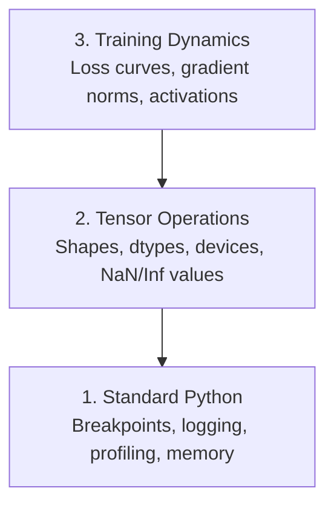

# Learning title generation

**Session ID:** ses_e841a960cffea8LXLoJOi0lAUR
**Created:** 10/27/2026, 11:16:34 AM
**Updated:** 10/28/2026, 9:43:10 AM

---

## User

learn

---

## Assistant (Build · GLM-5.3-Flash · 11.2s)

**Tool: skill**

---

## Assistant (Build · GLM-5.3-Flash · 5.3s)

**Tool: read**

---

## Assistant (Build · GLM-5.3-Flash · 4.6s)

**Tool: glob**

---

## Assistant (Build · GLM-5.3-Flash · 4.5s)

**Tool: read**

**Tool: read**

---

## Assistant (Build · GLM-5.3-Flash · 6.8s)

Welcome back! Last time you finished **Phase 0 · 11 — Linux for AI** with a clean 5/5, so let's warm up with two quick recall questions before today's lesson.

**Warm-up 1 of 2** (from Linux for AI):

You get `Permission denied` when trying to run a shell script. What command fixes this?

- A. `chown root script.sh`
- B. `mv script.sh /usr/bin/`
- C. `chmod +x script.sh`
- D. `sudo rm script.sh`

Reply with one letter: <A|B|C|D>.

---

## User

C

---

## Assistant (Build · GLM-5.3-Flash · 7.5s)

Correct — without the execute bit set, the shell refuses to run the script even if you own it.

**Warm-up 2 of 2**:

Your training data fills the disk on a remote GPU box. Which command shows the largest directories consuming space?

- A. `ls -la /`
- B. `cat /proc/meminfo`
- C. `du -h --max-depth=1 / | sort -hr | head -20`
- D. `free -h`

Reply with one letter: <A|B|C|D>.

---

## User

C

---

## Assistant (Build · GLM-5.3-Flash · 5.9s)

2/2 — you're warmed up. Today's lesson: **Phase 0 · 12 — Debugging & Profiling**.

## The Problem

AI code fails differently than regular code. A web app crashes with a stack trace. A misconfigured training loop runs for 8 hours, burns $200 in GPU time, and produces a model that predicts the mean of every input — *without ever raising an error*. The culprit was a tensor on the wrong device, a forgotten `.detach()`, or labels leaking into features. You need tools that catch these silent failures **before** they waste your time and compute.

## The Concept

AI debugging operates at three levels:



Most people jump straight to level 3 (staring at TensorBoard). But **80% of AI bugs live at levels 1 and 2** — so that's where we'll spend our time.

**Comprehension check before we touch code:**

A model trains for 8 hours with zero exceptions, but its loss curve looks flat and predictions are useless. Which of the following is the *most likely* class of bug, and which level of the pyramid would you check first?

- A. A syntax error — Level 1
- B. A silent bug like a shape mismatch, wrong-device tensor, or data leakage — Levels 1–2
- C. A bad loss curve — Level 3
- D. A crashed process — Level 1

What's your pick?

---

## User

B

---

## Assistant (Build · GLM-5.3-Flash · 7.1s)

Exactly right — silent bugs live at Levels 1–2, and that's exactly where we start. Let's build.

## Build It — Part 1: Print Debugging (Yes, It Works)

Print debugging gets dismissed. It shouldn't. For tensor code, a targeted print beats stepping through a debugger, because you need to see **shape, dtype, device, value range, and NaN** all at once — five things a debugger makes you inspect one at a time.

```python
def debug_print(name, tensor):
    print(f"{name}: shape={tensor.shape}, dtype={tensor.dtype}, "
          f"device={tensor.device}, "
          f"min={tensor.min().item():.4f}, max={tensor.max().item():.4f}, "
          f"mean={tensor.mean().item():.4f}, "
          f"has_nan={tensor.isnan().any().item()}")
```

What it does: takes any tensor and prints everything you'd want to know about it in one line.

Why it exists: for tensor code, the *most common* silent bugs are shape mismatches, wrong-device tensors, and NaNs creeping in — this one function catches all three patterns.

**Prediction question**: a model trains for 3 hours, loss goes to `NaN` at step 2000 but nobody noticed. If you had called `debug_print("loss", loss)` after every step, what field in that output would have told you the instant things went wrong?

---

## User

the has_nan line

---

## Assistant (Build · GLM-5.3-Flash · 20.6s)

Right — `has_nan=True` would have flagged it at step 2000 instead of step ~7000 when someone finally looked at the loss curve. Three hours of compute saved by one boolean.

## Build It — Part 2: Conditional `breakpoint()`

The built-in debugger is underrated for AI work. The trick isn't dropping a breakpoint everywhere — it's dropping one that only fires when something looks wrong:

```python
def training_step(model, batch, criterion, optimizer):
    inputs, labels = batch
    outputs = model(inputs)
    loss = criterion(outputs, labels)

    if loss.item() > 100 or torch.isnan(loss):
        breakpoint()

    loss.backward()
    optimizer.step()
```

What it does: the loop runs untouched for thousands of steps, and only pauses when loss spikes above 100 or goes NaN.

Why it exists: a 10,000-step run with an unconditional breakpoint means pressing `c` 10,000 times. Conditional means you stop exactly at the moment of failure — with every tensor still live in scope.

Once you're in, the useful commands:

- `p outputs.shape` — check shapes
- `p loss.item()` — see the loss value
- `p torch.isnan(outputs).sum()` — count NaNs
- `p model.fc1.weight.grad` — check gradients
- `c` to continue, `q` to quit

**Prediction question**: training has been fine for 1,999 steps, then loss = NaN at step 2000 and you're now sitting in the debugger. What's the *first* thing you'd inspect to figure out where the NaN was born — the loss itself, or something upstream of it?

---

## User

I would check for number of NaNs along with gradient information

---

## Assistant (Build · GLM-5.3-Flash · 12.3s)

Good instinct — and it's the right reflex: the NaN in the loss is a *symptom*, not the source. At step 2000 with `loss = NaN`, the most informative checks in order:

1. `p torch.isnan(outputs).sum()` — did the NaN appear in the **forward pass**? (division by zero, `log(0)` in a custom loss)
2. `p model.fc1.weight.grad` — were the **gradients** already NaN/Inf from the *previous* step? (exploding gradients poisoning the update)
3. `p inputs.min()` — did a zero or negative value sneak into the batch that a `log()` or division chokes on?

If outputs are clean but grads are NaN, the explosion happened *upstream in time*, not in this step — that's a gradient-clipping problem. If outputs are NaN, it's a forward-pass numerical bug. The debugger tells you which in about 10 seconds.

## Build It — Part 3: Logging (Beyond Quick Checks)

Prints are for the moment of debugging. **Logging** is for when your debugging goes beyond a quick check — or the run fails at 3 AM and the terminal output scrolled off screen:

```python
import logging

logging.basicConfig(
    level=logging.INFO,
    format="%(asctime)s [%(levelname)s] %(message)s",
    handlers=[
        logging.FileHandler("training.log"),
        logging.StreamHandler()
    ]
)
logger = logging.getLogger(__name__)

logger.info("Starting training: lr=%.4f, batch_size=%d", lr, batch_size)
logger.warning("Loss spike detected: %.4f at step %d", loss.item(), step)
logger.error("NaN loss at step %d, stopping", step)
```

What it gives you over print: timestamps, severity levels you can filter later, and a persistent `training.log` file you can grep after the fact. Severity levels also mean you can crank the level up (`WARNING`) in production without touching the code.

**Prediction question**: you have `logger.info` calls every step and `logger.warning` only on spikes. You want to see *only* the spikes in a long run — what one-line change does that?

---

## User

Commenting the logger.info() line?

---

## Assistant (Build · GLM-5.3-Flash · 24.8s)

Works, but it's the blunt instrument — you lose the info trail entirely and have to remember to un-comment it. The cleaner move is to change the *threshold*:

```python
logging.basicConfig(level=logging.WARNING, ...)
```

Now `INFO` messages are silently swallowed and `WARNING` and above pass through — no code edits, no forgotten un-commenting, and you can flip it back with one word. That's the whole point of severity levels: they're a runtime filter, not a code change.

## Build It — Part 4: Timing Code Sections

Knowing where time goes is the first step to optimization. The simplest tool is a context manager timer:

```python
import time

class Timer:
    def __init__(self, name=""):
        self.name = name

    def __enter__(self):
        self.start = time.perf_counter()
        return self

    def __exit__(self, *args):
        elapsed = time.perf_counter() - self.start
        print(f"[{self.name}] {elapsed:.4f}s")

with Timer("data loading"):
    batch = next(dataloader_iter)

with Timer("forward pass"):
    outputs = model(batch)

with Timer("backward pass"):
    loss.backward()
```

What it does: `__enter__` stamps `perf_counter()` at entry, `__exit__` subtracts at exit — any `with` block gets timed with zero changes to the code inside it.

Why `perf_counter` and not `time.time`: `time.time()` can jump when the system clock syncs (NTP adjust). `perf_counter()` is monotonic — it only ever moves forward — so durations are always real.

Common finding: data loading takes **60% of training time**. The fix is `num_workers > 0` in your DataLoader, not a faster GPU. You'd never know that without timing the three phases separately.

**Prediction question**: you time the three phases and get: data loading 0.42s, forward 0.08s, backward 0.15s. What's the fix — and is it a code fix or a hardware fix?

---

## User

Try increasing the number of workers to reduce the data loading time

---

## Assistant (Build · GLM-5.3-Flash · 23.8s)

Exactly — `num_workers > 0` in the DataLoader is the fix, and it's a *code fix*, not hardware. The GPU is starving at 60% idle waiting for batches; buying a faster GPU would make the starvation *more* expensive. Parallel workers prefetch the next batch while the GPU crunches the current one.

## Build It — Part 5: cProfile & line_profiler

Manual timers are great for three phases you already know about. When you *don't* know where the time goes, you need profiling:

```bash
python -m cProfile -s cumtime train.py
```

What it does: instruments every function call in the program and reports total calls, self-time, and **cumulative time** (sorted by `-s cumtime`). Cumulative time includes callees — so the top rows show the big branches of the call tree.

For line-by-line resolution, `line_profiler`:

```python
@profile
def train_step(model, data, target):
    output = model(data)
    loss = F.cross_entropy(output, target)
    loss.backward()
    return loss

# Run with: kernprof -l -v train.py
```

The workflow: **cProfile first** to find the hot function, then **line_profiler** on that one function to find the hot line. Don't start with line-level profiling — on a 200-line script it's noise.

## Build It — Part 6: Memory Profiling

**CPU memory with `tracemalloc`** (stdlib — always available):

```python
import tracemalloc

tracemalloc.start()

# your code here
model = build_model()
data = load_dataset()

snapshot = tracemalloc.take_snapshot()
top_stats = snapshot.statistics("lineno")
for stat in top_stats[:10]:
    print(stat)
```

The snapshot reports allocations grouped by source line — the top line is your memory hog.

**GPU memory with PyTorch** (the one that actually bites in AI work):

```python
print(torch.cuda.memory_allocated() / 1e9)  # actually in use
print(torch.cuda.memory_reserved() / 1e9)   # cached by the allocator
```

When you hit **OOM** (Out of Memory), the fix order is:

1. Reduce batch size (first thing to try, always)
2. `torch.cuda.empty_cache()` to free cached memory
3. `del tensor` + `empty_cache()` for large intermediates
4. Mixed precision (`torch.cuda.amp`) to halve memory usage
5. Gradient checkpointing for very deep models

**Prediction question**: you're OOM at batch size 128. What's the *first* thing you try, and what's the *last* thing you try before rearchitecting the model?

---

## User

The first thing to try is to reduce the batch size to 64. And the last thing would after trying emptying the cache and mixed precision would be to use gradient checkpointing.

---

## Assistant (Build · GLM-5.3-Flash · 22.5s)

Exactly right on both ends — batch size first (cheapest, one-line change), gradient checkpointing last (trades recompute-for-memory, costs ~30% extra time). And you've got the right middle order too: `empty_cache` is free, mixed precision is the big win before you pay the checkpointing tax.

## Build It — Part 7: The Four Classic AI Bugs

This is the heart of the lesson. Four silent bugs that account for most of the 8-hours-of-garbage disasters.

### Bug 1: Shape Mismatch

The most frequent bug. A tensor has shape `[batch, features]` when the model expects `[batch, channels, height, width]`. The trick for catching these *before* training: register a **forward hook** on every module and record the shape transformation:

```python
def check_shapes(model, sample_input):
    print(f"Input: {sample_input.shape}")
    hooks = []

    def make_hook(name):
        def hook(module, inp, out):
            in_shape = inp[0].shape if isinstance(inp, tuple) else inp.shape
            out_shape = out.shape if hasattr(out, "shape") else type(out)
            print(f"  {name}: {in_shape} -> {out_shape}")
        return hook

    for name, module in model.named_modules():
        hooks.append(module.register_forward_hook(make_hook(name)))

    with torch.no_grad():
        model(sample_input)

    for h in hooks:
        h.remove()
```

Run this once with a sample batch. It prints the entire shape map of your model — `fc1: [32, 784] -> [32, 128]` — so you can see exactly where the dimensions break. Note `h.remove()`: hooks are persistent, so if you don't remove them, they'd keep firing every forward pass and slow training down.

### Bug 2: NaN Loss

NaN means something exploded. Common causes: learning rate too high, division by zero in a custom loss, `log(0)`, or exploding gradients in RNNs.

```python
def detect_nan(model, loss, step):
    if torch.isnan(loss):
        print(f"NaN loss at step {step}")
        for name, param in model.named_parameters():
            if param.grad is not None:
                if torch.isnan(param.grad).any():
                    print(f"  NaN gradient in {name}")
                if torch.isinf(param.grad).any():
                    print(f"  Inf gradient in {name}")
```

This is your drill-down tool — once you *know* loss is NaN, it walks the parameters and tells you exactly which layer's gradient went bad.

### Bug 3: Data Leakage

Your model gets 99% accuracy on the test set. Sounds great. It's a bug.

```python
def check_data_leakage(train_set, test_set, id_column="id"):
    train_ids = set(train_set[id_column].tolist())
    test_ids = set(test_set[id_column].tolist())
    overlap = train_ids & test_ids
    if overlap:
        print(f"DATA LEAKAGE: {len(overlap)} samples in both train and test")
        return True
    return False
```

The killer detail: `train_ids & test_ids` — a **set intersection**. One line catches the disaster. Also watch for **temporal leakage**: using future data to predict the past. Sort by timestamp before splitting.

### Bug 4: Wrong Device

Tensors on different devices cause runtime errors — but sometimes a tensor silently stays on CPU while everything else is on GPU, and training just runs *slowly* instead of erroring.

```python
def check_devices(model, *tensors):
    model_device = next(model.parameters()).device
    print(f"Model device: {model_device}")
    for i, t in enumerate(tensors):
        if t.device != model_device:
            print(f"  WARNING: tensor {i} on {t.device}, model on {model_device}")
```

`next(model.parameters()).device` is the standard idiom for asking "where does the model live?"

**Comprehension check**: you've got a model that scores 99% test accuracy — suspiciously high. Which of the four bugs is the most likely culprit, and what *one* line of Python would you run to confirm or rule it out?

---

## User

It looks like a classic case of Data leakage. We can confirm it by cross checking the ids of train and test set and look for overlapping data.

---

## Assistant (Build · GLM-5.3-Flash · 21.6s)

Correct — data leakage it is. And the confirmation is exactly the set intersection:

```python
overlap = set(train_set["id"].tolist()) & set(test_set["id"].tolist())
print(len(overlap))  # > 0 means the test set is contaminated
```

One subtlety worth noting: an `id` column only catches *identity* leakage. Two rows can have different IDs but be near-duplicates (same image cropped twice, same patient appearing twice) — that's why real pipelines also do temporal splits and fuzzy-match checks. But for a first-line test, intersection on IDs catches the most common disaster.

## Build It — Part 8: TensorBoard

You've got the four bug-detectors. Now the tool that watches training *over time* — because some bugs only show up in the trajectory, not at a single step.

```python
from torch.utils.tensorboard import SummaryWriter

writer = SummaryWriter("runs/experiment_1")

for step in range(num_steps):
    loss = train_step(model, batch)

    writer.add_scalar("loss/train", loss.item(), step)
    writer.add_scalar("lr", optimizer.param_groups[0]["lr"], step)

    if step % 100 == 0:
        for name, param in model.named_parameters():
            writer.add_histogram(f"weights/{name}", param, step)
            if param.grad is not None:
                writer.add_histogram(f"grads/{name}", param.grad, step)

writer.close()
```

Launch with `tensorboard --logdir=runs` and open the browser. The code logs three kinds of signals — scalars (loss, lr), weight histograms, and gradient histograms. The real skill is reading them:

| Signal | Diagnosis |
|---|---|
| Loss not decreasing | LR too low, or architecture issue |
| Loss oscillating wildly | LR too high |
| Train loss ↓, val loss ↑ | Overfitting |
| Weight histograms collapsing to zero | Vanishing gradients |
| Gradient histograms exploding | Need gradient clipping |

The histograms are the part most people skip, and they're the most diagnostic. Scalars tell you *that* something is wrong; weight/gradient histograms often tell you *which layer* and *why*.

**Comprehension check**: your training loss has been steadily decreasing for 2 epochs, but your validation loss started going UP at epoch 1.5. What's happening, and what's the first lever you'd pull?

---

## User

It looks like the model is overfitting on the training data. I would like to know more on the weight/gradient histograms and how it works?

---

## Assistant (Build · GLM-5.3-Flash · 29.9s)

Right diagnosis — classic overfitting. First levers: early stopping, dropout, weight decay, or more data. (Validation loss turning up while train loss falls is the signature.)

Now the histograms — this is worth understanding properly, because most people log them without knowing what they're actually looking at.

## What `add_histogram` actually records

A weight tensor like `fc1.weight` of shape `[256, 128]` is 32,768 individual numbers. A scalar loss tells you nothing about what those 32,768 values are doing. The histogram answers: **at step N, what is the distribution of these values?**

Mechanically, it's just binning:

```python
# what add_histogram does under the hood, simplified:
counts, bin_edges = np.histogram(fc1.weight.detach().cpu().numpy(), bins=30)
# -> "at step 5000, 400 values fall in [-0.02, -0.01), 610 in [-0.01, 0.0), ..."
```

You log one of these per layer per interval:

```python
writer.add_histogram(f"weights/{name}", param, step)
```

TensorBoard then stacks these distributions across steps — you get a scrolling 3D view where each slice is "the distribution of this layer's weights at step N." The story is in how the shape *moves*.

## How to read the motion

| Pattern | Meaning |
|---|---|
| Gradients pile up in the bin at exactly 0, weights barely change | **Vanishing gradients** — signal died before reaching this layer |
| Gradient histogram spreads ever wider / spikes to huge magnitudes | **Exploding gradients** — needs clipping |
| Weights march steadily away from init toward larger values, gradients healthy and symmetric around 0 | **Healthy training** — this is what good looks like |
| A layer's histogram freezes after step ~200 while later layers keep moving | **Dead layer** (dead ReLUs, or a broken skip connection) |
| Gradients become asymmetrically lopsided | One-sided signal flow, often a masking or padding bug |

Two habits that make this usable:

1. **Compare early layers vs. late layers.** Vanishing gradients show up *first* in early layers (they're furthest from the loss). If layer 1's gradient histogram is collapsing while layer 10's looks fine, you've localized the problem.
2. **Log every ~100 steps, not every step.** Histograms are expensive to compute and store; every step just adds noise and slows the run.

**Quick check for you**: if you logged histograms and saw layer 1's gradient histogram tight around zero while layer 5's still spreads normally — is the vanishing gradient problem *upstream* or *downstream* of layer 1, and would gradient clipping fix it?

---

## User

Since layer 5's gradient spreads normally, layers upstream of 5 should not be facing vanishing gradient problem but same cannot be said for layers downstream of 5 since layer 1 is facing the problem.
Gradient clipping is used against exploding gradient problem and not for vanishing gradients.

---

## Assistant (Build · GLM-5.3-Flash · 31.3s)

Both points are correct — and your terminology is almost right, let me just sharpen it because it's the kind of thing that trips people up in team conversations.

**Direction**: in the forward pass, data flows input → layer1 → layer5 → output. But **gradients flow backward** — from the loss → layer5 → layer1. So layer 1 is *downstream* of layer 5 in the gradient flow, even though it's upstream in the data flow. Your instinct was right: if layer 1's gradients are collapsing while layer 5's are healthy, the signal died *between the loss and layer 1* — the problem is localized to layers between 5 and 1 (plus layer 1 itself). In a team conversation, always say "furthest from the loss" or "nearest to the loss" — that's unambiguous.

**Clipping**: exactly right. Gradient clipping caps the *max* norm — it can only shrink gradients, so it's useless for vanishing. The fixes for vanishing are:

- **Residual/skip connections** — give the gradient a highway around each layer
- **Better activations** — ReLU/GELU instead of sigmoid/tanh (sigmoid's derivative maxes at 0.25; multiply a few of those and the gradient vanishes)
- **Normalization** — BatchNorm/LayerNorm keep activations in a healthy range
- **Careful init** — He/Xavier initialization instead of plain random
- For RNNs specifically: **LSTM/GRU** gates

## Build It — Part 9: VS Code Debugger (the interactive version)

Everything we've done with `breakpoint()` and prints works in the terminal. VS Code gives you the same thing with a GUI:

```json
{
    "version": "0.2.0",
    "configurations": [
        {
            "name": "Debug Training",
            "type": "debugpy",
            "request": "launch",
            "program": "${file}",
            "console": "integratedTerminal",
            "justMyCode": false
        }
    ]
}
```

The key flag is `"justMyCode": false` — without it, you can't step *into* library code like PyTorch's `cross_entropy` or a DataLoader worker. When you're debugging a preprocessing pipeline and want to see each transformation, the gutter breakpoints plus the Variables pane plus the Debug Console (arbitrary Python expressions mid-execution) are genuinely faster than pdb.

That's the full lesson. Quick recap of the toolkit you now have:

1. `debug_print` — shape/dtype/device/NaN in one line
2. Conditional `breakpoint()` — stop only when things go wrong
3. `logging` — persistent, filterable, survives 3 AM failures
4. `Timer` / `cProfile` / `line_profiler` — find the slow thing
5. `tracemalloc` / `torch.cuda.memory_summary` — find the memory hog
6. The four bug detectors: shapes, NaN, leakage, devices
7. TensorBoard — watch training over time, read histograms

Ready for the post-quiz? Two questions, then I'll log your progress. Question 1:

You're profiling a training loop and find the DataLoader is the bottleneck — data loading takes 60% of the step time. What's the fix?

- A. Buy a faster GPU
- B. Set `num_workers > 0` in the DataLoader
- C. Reduce the batch size
- D. Use `torch.cuda.empty_cache()`

Reply with one letter: <A|B|C|D>.

---

## User

B

---

## Assistant (Build · GLM-5.3-Flash · 19.7s)

Correct — B. Data loading is a CPU/IO problem, so a faster GPU just means you wait more expensively. Parallel workers with `num_workers > 0` prefetch batches while the GPU trains.

Let me grab the final question:

**Tool: bash**

**Tool: bash**

---

## Assistant (Build · GLM-5.3-Flash · 6.3s)

Last question — 2 of 2:

You see NaN loss at step 500. Which approach will help you find the root cause?

- A. Switch from Adam to SGD optimizer
- B. Restart training from scratch with a different random seed
- C. Increase the batch size to stabilize gradients
- D. Use `detect_nan` to check for NaN/Inf in gradients and add `breakpoint()` at the failure point

---

## User

D

---

## Assistant (Build · GLM-5.3-Flash · 29.1s)

Correct — D. When loss goes NaN, `detect_nan` walks every parameter's gradient and tells you exactly which layer went NaN/Inf, and a conditional `breakpoint()` freezes the moment of failure so you can inspect tensors live. Options A–C are all "guess and restart" moves that treat the symptom.

That's a clean sweep — you handled all three post-checks correctly: **3/3**.

**Tool: edit**

---

## Assistant (Build · GLM-5.3-Flash · 6.0s)

**Tool: edit**

---

## Assistant (Build · GLM-5.3-Flash · 4.7s)

**Phase 0 · 12 complete — 3/3.** You can now profile a training loop, read the four classic silent-failure patterns (shape, NaN, leakage, device), and diagnose vanishing vs exploding gradients from TensorBoard histograms.

**Next: Phase 13 · 01 — The Tool Interface** — how an agent actually "reaches out" to execute code, and why the function-call boundary is the API of intelligence. When you're ready, say `learn` again.

---

## User

export-session-notes

---

## Assistant (Build · GLM-5.3-Flash · 4.8s)

**Tool: glob**

**Tool: bash**

---

## Assistant (Build · GLM-5.3-Flash · 3.1s)

**Tool: read**

---

## Assistant (Build · GLM-5.3-Flash · 17.3s)

**Tool: bash**

---

## Assistant (Build · GLM-5.3-Flash · 18.1s)

**Tool: write**

---

## Assistant (Build · GLM-5.3-Flash · 13.2s)

**Tool: write**

---

## Assistant (Build · GLM-5.3-Flash · 15.3s)

**Tool: write**

---

## Assistant (Build · GLM-5.3-Flash · 16.2s)

**Tool: write**

---

## Assistant (Build · GLM-5.3-Flash · 20.7s)

**Tool: write**

---

## Assistant (Build · GLM-5.3-Flash · 7.0s)

Session notes exported — 5 files in `phases/00-setup-and-tooling/12-debugging-and-profiling/session-notes/`:

- `00-index.md` — contents table + session facts (date, 3/3 quiz, warm-up recall, stumbles)
- `01-silent-failures-and-inspection.md` — three-level pyramid, `debug_print`, shape hooks, wrong-device check
- `02-conditional-breakpoints-and-logging.md` — `breakpoint()` on failure signals, NaN drill-down, severity levels, VS Code `launch.json`
- `03-performance-and-memory.md` — `Timer`/`perf_counter`, cProfile→line_profiler workflow, `tracemalloc`, OOM ladder
- `04-bugs-and-tensorboard.md` — data leakage intersection, `detect_nan`, histogram reading, vanishing vs exploding fixes

The stumbles worth re-reading are recorded in the index: the `num_workers > 0` fix (code, not hardware), how `add_histogram` binning works, and the gradient-flow "furthest from the loss" phrasing.

---

