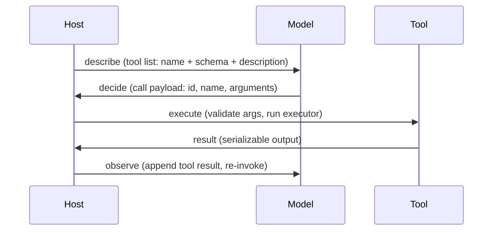

# The Four-Step Tool Loop and Ownership

## The problem in one sentence

An LLM's entire output surface is a probability distribution over the next token — it cannot dial into a weather API. The tool interface is the contract that closes the gap between "model produces tokens" and "program takes actions."

## The invariant: describe → decide → execute → observe

Every 2026 stack (OpenAI function calling, Anthropic `tool_use`, Gemini `functionDeclarations`, MCP `tools/call`, A2A task parts) encodes the same loop:

## Who owns each step — the correction that stuck

First attempt said host owns describe/decide/execute and model observes. Corrected to:

| Step | Owner | Why |
|---|---|---|
| describe | **Host** | Declares name, description, JSON Schema |
| decide | **Model** | The only step requiring judgment; reads user message + tool list |
| execute | **Host** | Validates arguments, runs real code — the host has hands |
| observe | **Host** | Appends `tool` role result, re-invokes the model |

Pattern to remember: **host does all the plumbing, model does exactly one thing — decide.** Judgment lives where the weights are, side effects live where the code is.

## Why the call `id` exists — the second correction

First instinct: the id helps the registry index/select tools. Wrong — that is what `name` is for.

The `id` exists for **result correlation**: when parallel calls are emitted in one turn and executed concurrently, results can come back out of order. The `id` answers "which of the several in-flight requests is this result for?" Without it, result A lands in conversation slot B and the model reasons over a scrambled world.

- `name` answers "which tool?"
- `id` answers "which in-flight request does this result belong to?"

## Decision shapes

`fake_decide` reproduces the real contract: the decision is always one of:

1. final text (`content`) — answer directly, no tool
2. call objects (`tool_calls` with `id`/`name`/`arguments`) — one or many (parallel)
3. refuse (typed refusal block under strict mode)

## Where the loop lives (provider table)

| Context | Who describes | Who decides | Who executes |
|---|---|---|---|
| Single-turn function calling | App developer | LLM | App developer |
| MCP | MCP server | LLM via MCP client | MCP server |
| A2A | Agent Card publisher | Calling agent | Called agent |
| Browser (WebMCP) | Browser extension | LLM | Browser runtime |

Same four steps everywhere; column names change, structure does not.